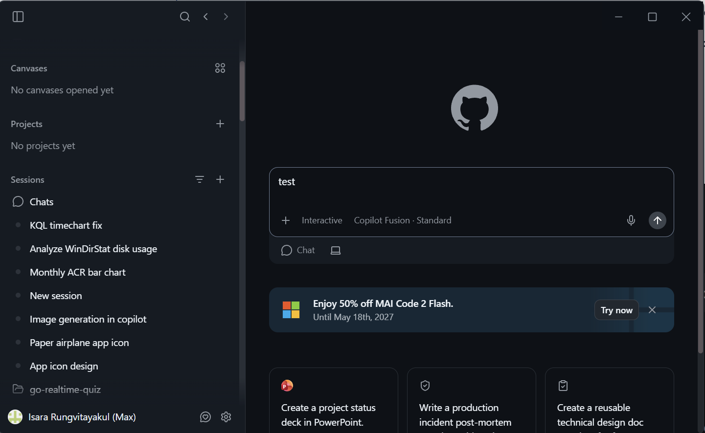
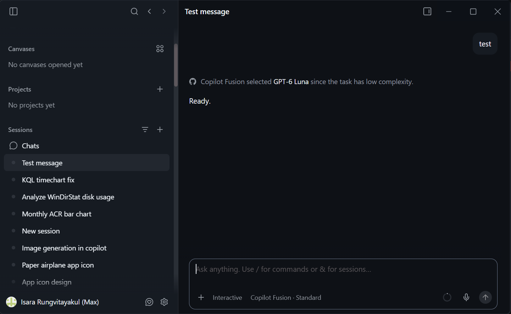
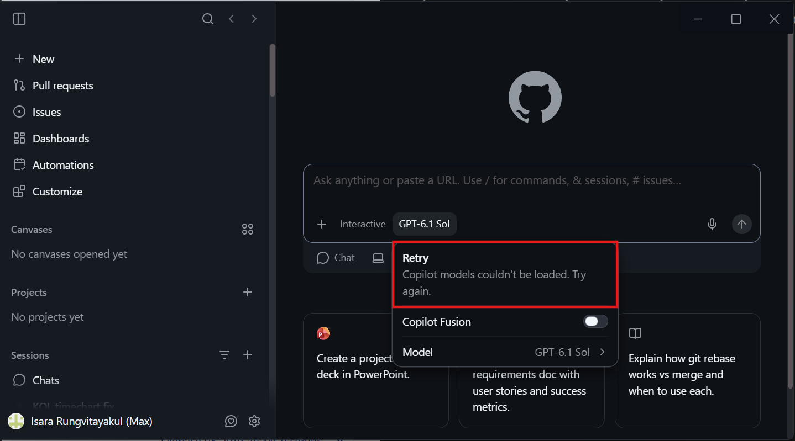
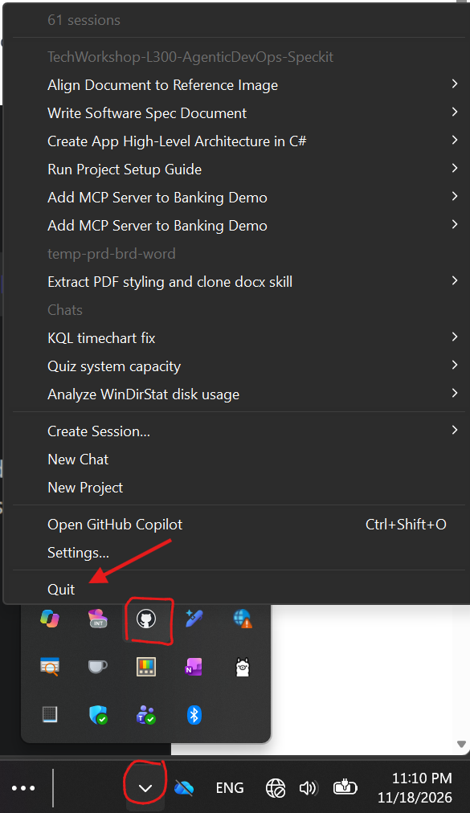

# Task 04 - Check GitHub Copilot access

Use your GitHub account with Copilot access, then send a test message in Copilot Chat.

If you are already signed in with the correct account, skip to **Test GitHub Copilot**.

<details markdown="block">
<summary><strong>Select or sign in with your Copilot account</strong></summary>

1. In VS Code or your Codespace, open **Extensions**, search for **GitHub Copilot Chat**, and open its extension page. Click the **gear icon**.

   

2. Select **Account Preferences**.

   

3. Select **GitHub**.

   

4. Choose your account with Copilot access, or select **Use a new account...** to sign in.

   

5. If the browser opens, select your account and click **Continue**, or choose **Use a different account**. Follow the prompts to finish signing in.

   

</details>

## Test GitHub Copilot in VSCode

Open **Copilot Chat**, send **Hello Test**, and confirm that Copilot replies. The wording of the reply may differ from the screenshot.


If you cannot sign in or receive a reply, follow the [official Copilot setup guide](https://code.visualstudio.com/docs/setup/copilot) or ask your instructor for help.

## Test GitHub Copilot in GitHub Copilot App

{: .note }
> This test applies only if you installed the optional GitHub Copilot app in [Task 02]().

1. Open the **GitHub Copilot** app and sign in with your GitHub account if prompted.
2. In the prompt box, type **test** and send it.

   

3. Confirm that Copilot replies. The model name and wording of the reply may differ from the screenshot.

   

### Fix: Copilot models couldn't be loaded

If the app shows **Copilot models couldn't be loaded. Try again.** when you open the model list, the app cannot reach GitHub Copilot, usually because it does not use your HTTP proxy.



1. Close the app completely, including its background process. In the Windows system tray (select the **^** arrow to show hidden icons), right-click the GitHub Copilot icon and select **Quit**.

   

2. Open PowerShell, set the proxy variables for that session using the values from your instructor, and launch the app from the same window:

   ```powershell
   $env:HTTP_PROXY = "http://PROXY_HOST:PROXY_PORT"
   $env:HTTPS_PROXY = "http://PROXY_HOST:PROXY_PORT"
   & "C:\Program Files\Github Copilot\github.exe"
   ```

   If the app is installed in a different folder, use that path to `github.exe`.

3. Open the model list again and send a test prompt.

To avoid repeating this, set the proxy variables permanently as described in [Task 03](), then quit the app and start it again.
