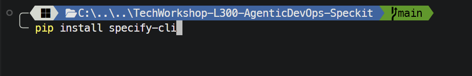

# Task 01 - Install the Specify CLI

## Introduction

Spec Kit provides a CLI for setting up a spec-driven development workflow.

## Description

Verify the Specify CLI. In GitHub Codespaces or the repository development container, it is installed automatically (pinned to Spec Kit `v1.2.6`) when the container is created. In other environments, install it using an approved method. Initialization is a separate task.

## Success Criteria

- The `specify` command is available in your terminal.
- You can report its version and know how it was installed.

## Learning Resources

- [Spec Kit installation](https://github.github.io/spec-kit/installation.html)
- [pip documentation](https://pip.pypa.io/en/stable/)

## Key Tasks

1. Run `specify version` to check whether the CLI is already available.
2. If it is not available (for example, in a local environment without the development container), confirm that your environment meets the current Python and pip prerequisites.
3. If installation is needed, use the pinned release used by the development container:


In PowerShell, with Git, Python, and pip available:

```powershell
python -m pip install "git+https://github.com/github/spec-kit.git@v1.2.6"
```

Open a new terminal after installation so your PATH is refreshed.


In Terminal, with Git, Python, and pip available:

```bash
python3 -m pip install "git+https://github.com/github/spec-kit.git@v1.2.6"
```

Open a new terminal after installation so your PATH is refreshed.


**GitHub Codespaces:** The CLI is installed automatically during container creation. Skip installation and verify it below.

**Local Linux:** With Git, Python, and pip available, install the CLI:

```bash
python3 -m pip install "git+https://github.com/github/spec-kit.git@v1.2.6"
```

If pip reports an externally managed environment, create and activate a virtual environment first (`python3 -m venv .venv`). Open a new terminal after installation so your PATH is refreshed.



The Windows example below shows installation from the pinned `v1.2.6` release (the screenshot was captured with an earlier installer; use the pip command above). Wait for installation to finish before verifying the CLI.



Run the same verification command on every platform:

```bash
specify version
```

Confirm that the output reports **CLI Version 1.2.6**. The screenshot also lists Python, platform, and architecture details; these depend on your environment and do not need to match the Windows example.


If `specify` is not recognized after installation, open a new terminal so the PATH update takes effect, then retry. Continue to [Task 02 - Initialize Spec Kit]() once verification succeeds.
